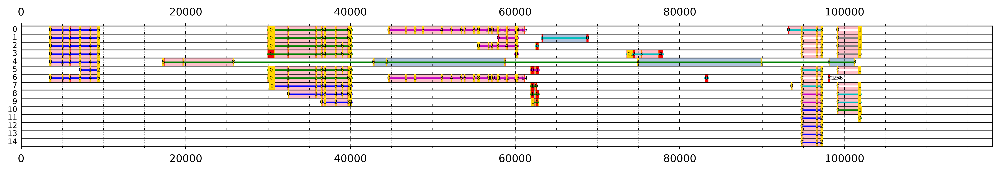

# lrRNAseq TAST command-line tool

lrRNAseq TAST (Total Alignment Search Tool) aligns full-length long-read RNAseq transcripts to a short genomic region (for example a ~100 kb BAC) and plots all the alignments together. The plot shows where genes are and how they are spliced.

This repository is the command-line version of lrRNAseq TAST. It runs in one command:

```
tast -t transcripts.fasta -g region.fasta -o results
```

The command runs BLAST, filters the transcripts, finds their open reading frames and draws the plot. On the example data it takes about 5 seconds.



*Example output for the BAC Ef318A10. Each row holds one or more transcripts; numbers show the position of each aligned region in its transcript.*

## Installation

You need **Python 3.9 or newer**. BLAST+ is also needed if you want TAST to run BLAST for you.

### 1. Python

If you don't have Python, install [Miniconda](https://docs.anaconda.com/miniconda/) or Python from [python.org](https://www.python.org/downloads/). On Windows, open the **Anaconda Prompt** (Miniconda) or **Command Prompt** (python.org) for the commands below.

### 2. TAST

```
pip install https://github.com/Maxim-Karpov/lrRNAseq-TAST_cli/archive/refs/heads/main.zip
```

Check it works:

```
tast --version
```

If your computer says `tast` is not recognised, use `python -m tast` instead of `tast` in all commands.

### 3. BLAST+ (optional)

- **Windows:** download the `ncbi-blast-...-win64.exe` installer from the [NCBI BLAST+ download page](https://ftp.ncbi.nlm.nih.gov/blast/executables/blast+/LATEST/). Run it, then open a new prompt and check that `blastn -version` works.
- **Linux / macOS:** `conda install -c bioconda blast`, or `sudo apt install ncbi-blast+`.

You can skip BLAST+ if you already have BLAST results. Pass them with `--blast` (see below).

## Usage

### Run everything

```
tast -t transcripts.fasta -g region.fasta -o results
```

On a powerful computer, add `--threads 8` (or however many CPU cores you have) to make BLAST faster. This needs BLAST+ 2.12 or newer.

### Re-plot with different filters, without running BLAST again

The first run saves the BLAST result as `results/blast_hits.tsv`. Reuse it to try other settings in seconds:

```
tast -t transcripts.fasta -b results/blast_hits.tsv -o results_cov50 --min-coverage 50
```

### Try it on the example data

Download this repository, open a prompt in its folder, and run:

```
tast -t example/all_transcripts.fasta -g example/Ef318A10.fst -b example/lrRNAseq_to_Ef318A10.out --barcode-len 39 -o example_results
```

### Using your own BLAST results

The BLAST file must use this exact output format, with the genomic region as the subject:

```
blastn -task blastn -query transcripts.fasta -subject region.fasta -evalue 1e-6 -outfmt "6 qseqid sseqid slen qlen qstart qend sstart send length mismatch gapopen pident evalue bitscore" -out hits.tsv
```

## Output

The output folder contains:

| File | Contents |
|---|---|
| `tast_plot.png` | The plot. Rows are numbered on the left. |
| `plot_rows.tsv` | Which transcripts are in each plot row, with their genomic position, strand, coverage, largest intron, largest ORF, region numbers in genomic order, and `region_order`: `forward`, `reverse`, `mixed` (rearrangement or repeat) or `single`. Filter on `mixed` to find unusual transcripts quickly. |
| `transcripts.tsv` | Every transcript in the BLAST result, with its statistics and whether it was plotted or why it was removed. |
| `filtered_ids.txt` | IDs of the transcripts that passed the strand, intron and coverage filters. |
| `filtered_transcripts.fasta` | Sequences of those transcripts. |
| `blast_hits.tsv` | The BLAST result, if TAST ran BLAST. |
| `run_info.txt` | The command, all settings and the TAST version, so a run can be repeated. |

### Reading the plot

- **Red blocks:** regions of the genome where a part of a transcript aligned.
- **Coloured lines:** the extent of each transcript. When a row holds several transcripts, each has its own colour.
- **Gold outline:** the aligned part of the transcript overlaps one of its ORFs.
- **Gold fill:** the aligned part overlaps the transcript's largest ORF.
- **Numbers:** the position of each aligned region within its transcript, where 0 is the region nearest the transcript's 5' end. Regions where the same part of the transcript aligned more than once share a number. Reading along the genome:
  - `0 1 2 3 …` is a gene on the forward strand.
  - `… 3 2 1 0` is a gene on the reverse strand.
  - Out-of-order numbers show rearrangements, or repeats inside the transcript.
- **Background:** colinear blocks, meaning runs of regions whose numbers keep going the same way. **Pink** means the numbers increase along the genome (forward), or the block is a single region. **Blue** means they decrease (reverse). A transcript split into several blocks has a rearrangement or repeat.

The numbering assumes transcripts are oriented 5'→3', as full-length (FLNC/CCS) reads normally are.

## Options

| Option | Default | Meaning |
|---|---|---|
| `-t`, `--transcripts` | required | Long-read transcripts (FASTA). |
| `-g`, `--genome` | | The genomic region (FASTA with one sequence). Needed to run BLAST. |
| `-b`, `--blast` | | Use an existing BLAST result instead of running BLAST. |
| `-o`, `--outdir` | `tast_results` | Output folder. |
| `--strand` | `dominant` | Which alignment strand to keep for each transcript. `dominant` keeps the strand with the highest total bitscore. `both` keeps all alignments, as TAST 1.0 did. `plus` and `minus` keep one strand only. |
| `--max-intron` | `20000` | Remove transcripts whose largest gap between alignments is this many bp or more. |
| `--min-coverage` | `25` | Remove transcripts with this % or less of their length aligned. |
| `--barcode-len` | `0` | Bases trimmed from both ends of each transcript before ORFs are found (39 for the example data). ORF positions are shifted back automatically to match BLAST. |
| `--min-orf-len` | `26` | ORFs must be longer than this many nucleotides. Transcripts without one are not plotted. |
| `--evalue`, `--word-size` | `1e-6`, `11` | BLAST settings. |
| `--threads` | `1` | CPU threads for BLAST. |
| `--blast-options` | | Any other blastn options, in quotes. |
| `--format` | `png` | `png`, `pdf` or `svg`. Use pdf or svg for very large plots. |
| `--dpi` | `140` | PNG resolution. |
| `--min-gap` | `0` | Minimum distance in bp between transcripts sharing a row. |
| `--no-row-numbers` | | Don't number the rows. |
| `-q`, `--quiet` | | Only print warnings and errors. |

Run `tast --help` to see the full list.

## Running the tests

```
pip install pytest
pytest
```

The tests check results on the example data against the expected output. BLAST tests are skipped if BLAST+ is not installed.

## Licence

MIT. See [LICENSE](LICENSE).

## Notebook version

lrRNAseq TAST is also available as a set of Jupyter notebooks: [lrRNAseq-TAST](https://github.com/Maxim-Karpov/lrRNAseq-TAST). Both versions perform the same analysis and, with the same settings, give identical results. The notebook version has these benefits:

- **Step-by-step and interactive.** Each stage of the analysis is a separate cell, so you can stop at any point and inspect the intermediate tables (the BLAST alignments, transcript coverage and intron lengths, ORFs, and the arrangement of transcripts into rows). This is useful for understanding the results for a difficult region, or for troubleshooting.
- **Easy to customise.** Any step can be edited in place: add your own filter, change how the plot is drawn, or try a new idea, without changing a packaged program.
- **Plots appear next to the code**, which suits exploration and teaching.
- **Documented data structures.** It comes with a [worked example](https://github.com/Maxim-Karpov/lrRNAseq-TAST/blob/main/Docs/example_demo.md) that explains each step and the tables it produces, and with [example visualisations](https://github.com/Maxim-Karpov/lrRNAseq-TAST/blob/main/Docs/visual_examples.md).
- **A library of extra sequence-analysis functions** (`bioinformatic_functions.ipynb`), such as ORF statistics, poly(A) tail detection, translation and k-mer counting, which can be used for wider analyses.

Use the command-line tool for routine runs, many genomic regions, or reproducible results; use the notebooks to explore a region in depth or to develop new filters.
